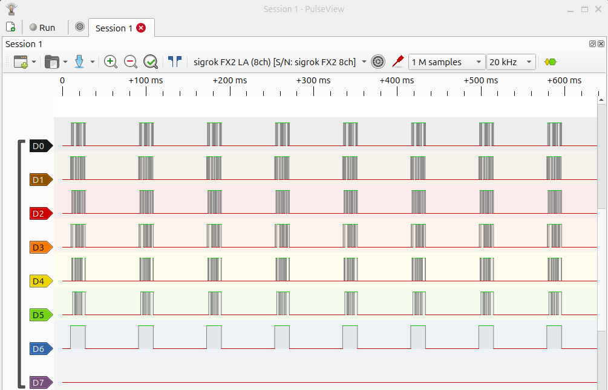
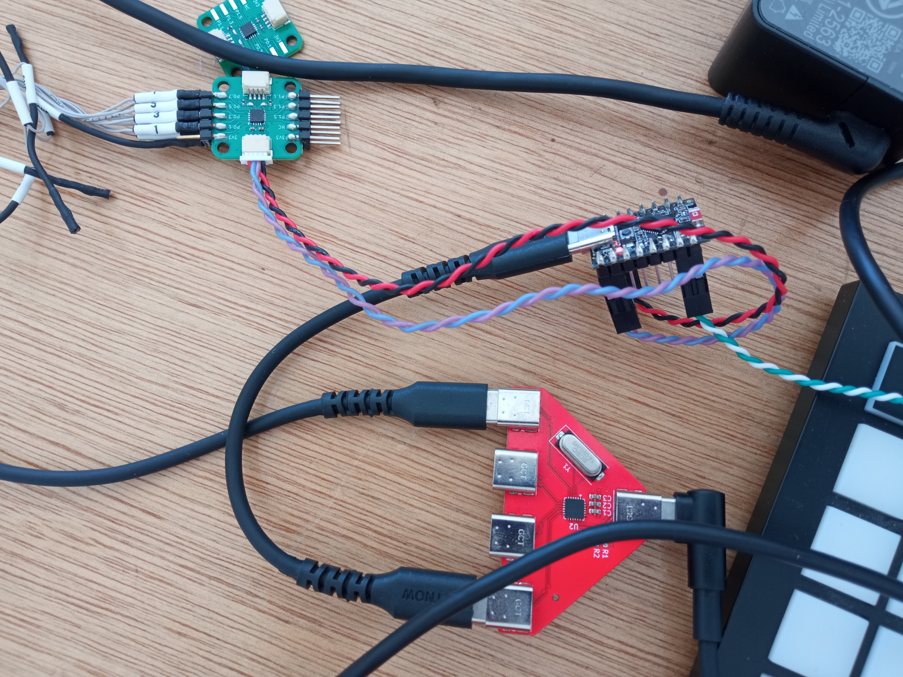
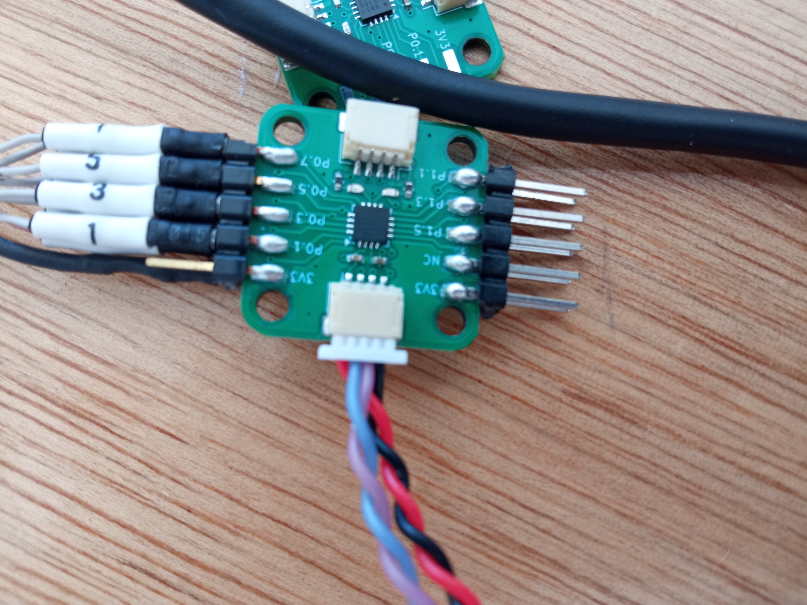

# Description
8 pins? 8 problems? This is a hardware challenge, come to the pwnies tent to receive the handout.

## TL;DR
Hardware challenge. Handout er en 8051 chip flashet med `pin_chal.ihx` som beskrevet nedenfor.

# Flag
`BHCTF{look_ma_teh_pins_are_wigglin}`

# Setup

0. Nødvendige tools: `espflash` (`cargo install`), `sdcc` (e.g. `apt`), `pulseview`.

1. Forbind 8051 chip til PC ved at koble stikket med lilla/blå og sort-rød ledning til connectoren i den side hvor der på forsiden er pins markeret med `3v3`. 

2. Åben flasher-toolet:
```
cd esp-efm8-flasher
ESP_LOG=debug cargo run --release
```
Toolet skriver navnet på serielporten e.g `/dev/ttyACM0`.

3. I en anden terminal, måske er det nødvendigt at være root:
```
(echo ihex; cat pin_chal.ihx; echo) > /dev/ttyACM0
```

4. Verificer at chippen sender data ud på `P0` pins: pinlæseren kan findes med en `fx2lafw` driver i `pulseview`. Det ser ca. sådan her ud:


# Solution-ish

Læs alle P0 pins samtidig. Programmet skriver med jævne mellemrum flaget indkodet som ASCII en byte af gangen.

#### ekstra billeder



